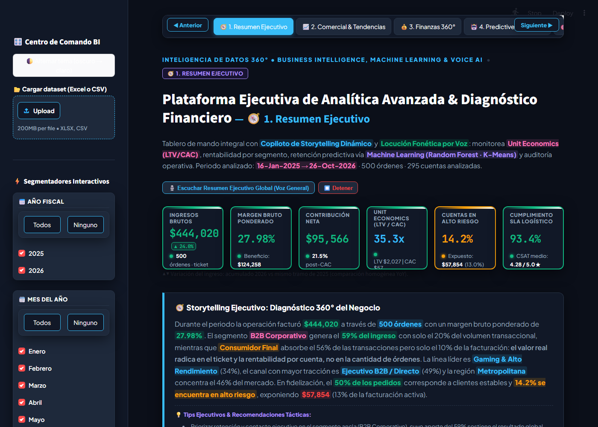
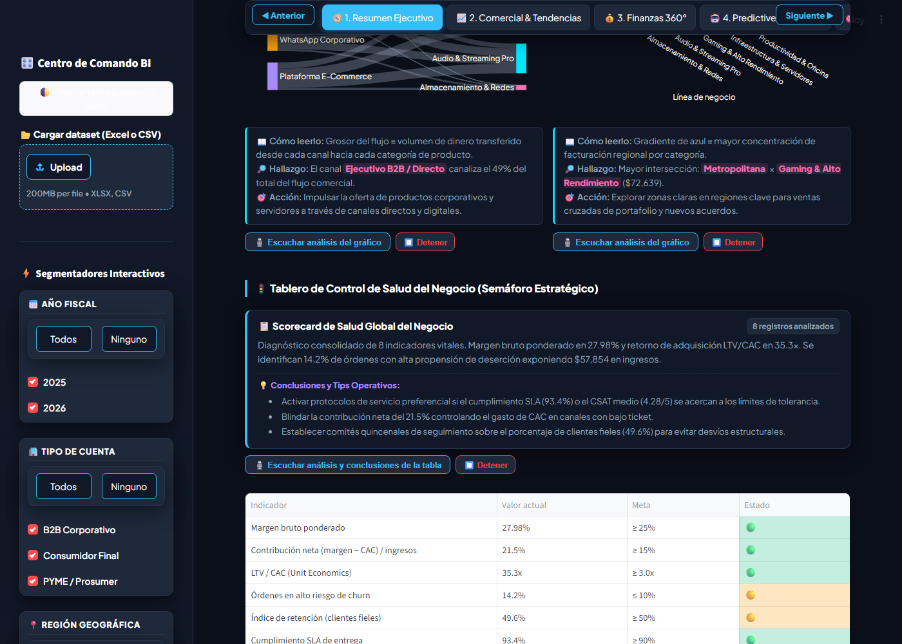
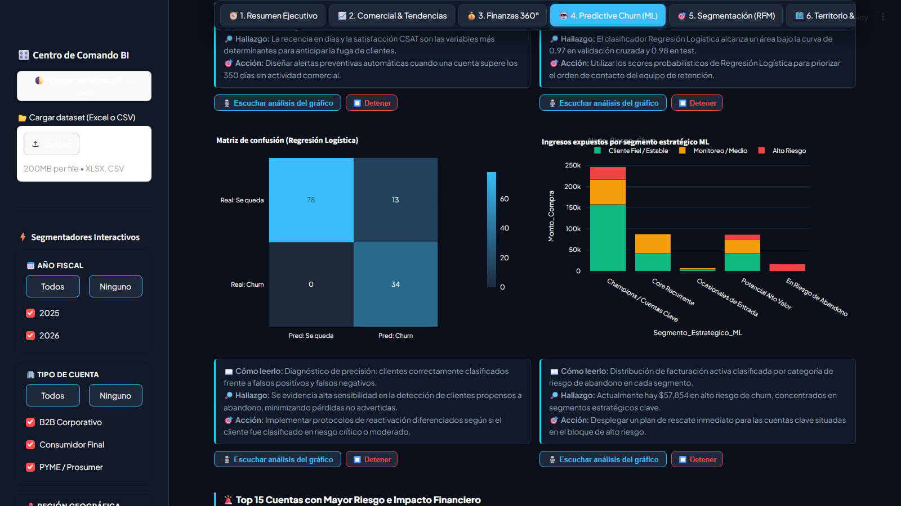

# 📊 Plataforma Ejecutiva de Analítica Avanzada & Diagnóstico Financiero 360°
### *Business Intelligence, Machine Learning Supervisado & No Supervisado, Copiloto de Storytelling Dinámico y Síntesis Fonética por Voz (Voice AI)*

[](https://plataforma-ejecutiva-bi-storytelling-ml.streamlit.app/)
[](https://plataforma-ejecutiva-bi-storytelling-ml.streamlit.app/)


> ### 🌐 **Acceso Directo a la Aplicación en Vivo**
> Accede e interactúa en tiempo real con el dashboard, los modelos predictivos de Machine Learning y la locución fonética por voz en Streamlit Cloud:  
> 🔗 **[https://plataforma-ejecutiva-bi-storytelling-ml.streamlit.app/](https://plataforma-ejecutiva-bi-storytelling-ml.streamlit.app/)**

---

## 🧭 Visión General del Proyecto

La **Plataforma Ejecutiva de Analítica Avanzada & Diagnóstico Financiero** ([visitar demo interactiva](https://plataforma-ejecutiva-bi-storytelling-ml.streamlit.app/)) es un centro de comando integral de Business Intelligence y Ciencia de Datos diseñado para comités de dirección, directores de finanzas (CFO), operaciones (COO) y ventas (CRO).

Integra en una única experiencia interactiva:
1. **Modelado Financiero 360°**: Desglose P&L de facturación, costo directo (COGS), margen bruto retenido, inversión en adquisición (CAC total) y margen de contribución neta, junto con Unit Economics clave (`LTV/CAC`).
2. **Machine Learning Supervisado (Predictive Churn)**: Clasificación y discriminación probabilística de riesgo de abandono mediante ensemble de Random Forest, Gradient Boosting y Regresión Logística con validación cruzada estratificada (5-Fold CV) y curvas ROC.
3. **Machine Learning No Supervisado (Clustering RFM)**: Segmentación conductual multivariada mediante K-Means y análisis PCA con diagnóstico de K óptimo (Método del Codo y Coeficiente de Silueta).
4. **Copiloto de Storytelling Dinámico con Voz (Voice AI)**: Narraciones ejecutivas generadas en tiempo real que se adaptan a los filtros activos, acompañadas de sintetizadores de voz fonéticos en español basados en la **Web Speech API**, que leen tanto los diagnósticos de los gráficos como las conclusiones y tips operativos de cada tabla.
5. **Navegación Fija & Arquitectura Bento Grid**: Barra de navegación sticky con 11 pestañas temáticas, tarjetas KPI con animaciones de ola marina y esquemas cromáticos divergentes calibrados para accesibilidad y alto contraste.

---

## 📸 Galería Visual de la Plataforma

<div align="center">

### 🧭 Vista Ejecutiva Principal & Centro de Comando BI


### 🎙️ Scorecard de Salud con Resumen Ejecutivo, Tips y Locución por Voz (Web Speech API)


### 🤖 Inteligencia Predictiva: Machine Learning Supervisado para Retención de Clientes


</div>

---

## 🎛️ Las 11 Pestañas Analíticas

```
┌────────────────────────────────────────────────────────────────────────────────────────┐
│ 🧭 1. Resumen  │ 📈 2. Comercial │ 💰 3. Finanzas │ 🤖 4. Churn ML │ 🎯 5. RFM │ 🗺️ 6. Territorio │
│ 👥 7. Clientes │ 👔 8. Vendedores │ 📦 9. Catálogo │ 📐 10. Estadíst. │ 📋 11. Auditoría │
└────────────────────────────────────────────────────────────────────────────────────────┘
```

### 1. 🧭 Resumen Ejecutivo
* **Scorecard de Salud Global**: Semáforo estratégico de 8 indicadores vitales (Margen %, Contribución neta %, LTV/CAC, Churn, SLA logístico, CSAT).
* **Treemap Financiero**: Mapa de calor jerárquico de categorías y SKUs con escala semafórica según margen bruto.
* **Flujos Sankey & Heatmaps**: Mapeo del origen de ingresos desde el canal comercial hasta la línea de negocio y distribución regional.
* **Narrativa de Audio y Tips**: Diagnóstico automatizado con locución por voz y tips ejecutivos de rescate de facturación en riesgo.

### 2. 📈 Comercial & Tendencias
* **Evolución Temporal**: Ventas mensuales, media móvil trimestral (3m) y regresión lineal con pendiente de tendencia e índice $R^2$.
* **Descomposición Sunburst**: Flujo anular de Tipo de Cuenta → Canal de Venta.
* **Estacionalidad Cruzada**: Heatmap mensual por canal de venta.
* **Tabla de Rendimiento por Canal**: Ticket promedio, margen comercial, costo de adquisición (CAC) y ratio multiplicador Margen / CAC.

### 3. 💰 Finanzas 360° & Márgenes
* **Cascada Financiera (Waterfall)**: De Facturación Bruta → COGS → Margen Bruto → Inversión CAC → Contribución Neta final.
* **Sensibilidad de Descuentos**: Impacto de descuentos comerciales (0% al 20%) sobre el margen retenido.
* **Retorno sobre CAC**: Margen generado por cada $1 invertido en adquisición desglosado por segmento.
* **P&L por Línea de Negocio**: Estado de resultados consolidado por categoría comercial.

### 4. 🤖 Predictive Churn (Machine Learning) & What-If
* **Ensemble Supervisado**: Comparativa de Random Forest, Gradient Boosting y Regresión Logística con curvas ROC y matrices de confusión.
* **Importancia de Variables**: Identificación de los pesos relativos predictores del abandono (Recencia, CSAT, Frecuencia, Descuentos).
* **Simulador Interactivo What-If**: Sliders para evaluar en vivo la probabilidad estimada de churn de un cliente según días de inactividad, frecuencia, satisfacción y volumen de compra.
* **Top 15 Cuentas en Riesgo Crítico**: Tabla priorizada con cálculo exacto del capital expuesto y acciones recomendadas (Retención VIP, Contacto Inmediato, Monitoreo).

### 5. 🎯 Segmentación K-Means & RFM
* **Diagnóstico de Clústeres**: Curvas de Inercia (Codo) y Coeficiente de Silueta para seleccionar $K$ entre 2 y 6 grupos.
* **Reducción de Dimensionalidad PCA**: Mapeo bidimensional de los patrones de compra de los clientes.
* **Matriz RFM 5x5**: Heatmap de Recencia ($R$) vs Frecuencia ($F$) con volumen facturado.
* **Perfil Conductual y Estrategia**: Tabla de acciones comerciales diferenciadas por clúster (Élite VIP, Alto Potencial, Núcleo Recurrente, Enfriamiento, Dormidos).

### 6. 🗺️ Territorio & Operaciones Logísticas
* **Desempeño Regional**: Facturación y margen bruto por macro-regiones geográficas.
* **Cuellos de Botella Logísticos**: Heatmap de tasa de entregas demoradas por combinación de Región × Canal.
* **Impacto Logístico en CSAT**: Análisis del castigo en calificaciones de satisfacción ante entregas fuera del SLA.
* **Top 10 Plazas Comerciales**: Ranking de ciudades líderes en facturación.

### 7. 👥 Clientes Pareto 80/20 & Cartera ABC
* **Curva de Lorenz (Pareto)**: Verificación visual de concentración donde el 20% superior genera más del 70% de la facturación.
* **Distribución ABC**: Segmentación de cartera en Clase A (80%), Clase B (15%) y Clase C (5%).
* **Matriz Valor vs Riesgo**: Gráfico de dispersión cruzando volumen facturado, riesgo de deserción y LTV estimado.
* **Top 20 Cuentas Estratégicas**: Ranking con auditoría de recurrencia, margen y satisfacción.

### 8. 👔 Fuerza de Ventas 360°
* **Score Compuesto Ponderado**: Evaluación integral de asesores considerando 30% volumen, 25% margen retenido, 15% CSAT, 15% retención de cuentas y 15% disciplina en descuentos.
* **Cumplimiento de Metas**: Comparativa interactiva de ventas reales vs cuota asignada con slider de metas dinámico.
* **Eficiencia de Negociación**: Dispersión de descuento otorgado frente a margen logrado.

### 9. 📦 Portafolio & Matriz BCG
* **Cuadrantes de Portafolio**: Clasificación automática en SKUs Estrella, Volumen (Vaca lechera), Nicho Rentable y Revisar.
* **Treemap Jerárquico**: Desglose de ingresos y margen bruto ponderado por SKU.
* **Dispersión de Precios Unitarios**: Diagrama de cajas (box plot) en escala logarítmica por categoría.

### 10. 📐 Estadística Avanzada & Pruebas de Hipótesis
* **Matriz de Correlación No Paramétrica**: Coeficientes de correlación monótona de Spearman ($\rho$).
* **Distribución y Asimetría**: Histogramas con cajas marginales y cálculo de asimetría (*skewness*).
* **Pruebas de Hipótesis (95% Confianza)**:
  * Correlaciones de Spearman (Recencia $\leftrightarrow$ Churn, CSAT $\leftrightarrow$ Churn, Descuento $\leftrightarrow$ Margen).
  * Prueba de Kruskal-Wallis para varianza de margen entre líneas de negocio.
  * Prueba U de Mann-Whitney para comprobar el impacto del retraso en el CSAT.

### 11. 📋 Auditoría Operativa & Calidad de Datos
* **Explorador Transaccional Granular**: Filtros por búsqueda de texto, niveles de alerta y ordenamiento multi-criterio.
* **Descarga Multi-formato**: Exportación directa a CSV y Excel (`.xlsx`) enriquecido.
* **7 Controles Automáticos de Integridad**: Verificación en tiempo real de unicidad de ID, nulidad en campos críticos, consistencia contable (`Monto - Costo = Margen`), límites de porcentajes y escala CSAT.

---

## 📁 Estructura del Dataset (`dataset_analytics_storytelling_ml_500.xlsx`)

El conjunto de datos incluye 500 órdenes representativas de una empresa de tecnología y suministros corporativos:

| Variable | Tipo | Descripción |
|:---|:---:|:---|
| `Cliente_ID` | Numérico | Identificador único de transacción y cliente |
| `Nombre_Cuenta_Cliente` | Texto | Nombre de la razón social o cuenta corporativa |
| `Tipo_Cliente_Cuenta` | Categórico | B2B Corporativo, Consumidor Final, PYME / Prosumer |
| `Region` | Categórico | Metropolitana, Cibao / Norte, Este, Sur |
| `Ciudad` | Texto | Ciudad donde se registró la entrega o sucursal |
| `Canal_Venta` | Categórico | Ejecutivo B2B / Directo, E-Commerce, Showroom, WhatsApp |
| `Vendedor_Asignado` | Categórico | Asesor comercial a cargo de la cuenta |
| `Categoria` | Categórico | Infraestructura & Servidores, Gaming & Alto Rendimiento, etc. |
| `Producto_Principal` | Texto | SKU insignia adquirido en la transacción |
| `Fecha_Transaccion` | Fecha | Timestamp de la compra (rango 2025–2026) |
| `Cantidad_Productos` | Entero | Volumen físico de unidades en la orden |
| `Monto_Compra` | Moneda ($) | Facturación bruta de la orden |
| `Costo_Total` | Moneda ($) | Costo directo de mercancías vendidas (COGS) |
| `Margen_Bruto` | Moneda ($) | Utilidad bruta (`Monto_Compra - Costo_Total`) |
| `Margen_Bruto_Pct` | Porcentaje | Margen porcentual (`Margen / Monto * 100`) |
| `Descuento_Pct` | Porcentaje | Descuento comercial aplicado a la orden |
| `CAC_Estimado` | Moneda ($) | Costo de adquisición de cliente imputado |
| `LTV_Estimado_USD` | Moneda ($) | Valor de vida proyectado de la cuenta |
| `Satisfaccion_CSAT` | Escala 1-5 | Calificación de satisfacción del cliente |
| `SLA_Entrega_Dias` | Entero | Tiempo de entrega en días hábiles |
| `Estado_Entrega` | Categórico | "Entregado a Tiempo" / "Con Retraso Logístico" |
| `Recencia_Dias` | Entero | Días transcurridos desde la última compra |
| `Frecuencia_Historica`| Entero | Número de transacciones acumuladas por la cuenta |
| `Riesgo_Churn_Score` | Probabilidad | Score numérico de propensión de fuga (0.00 a 1.00) |
| `Alerta_Riesgo_Churn` | Categórico | "Cliente Fiel / Estable", "Monitoreo / Medio", "Alto Riesgo" |

---

## 🚀 Instalación y Ejecución Local

### Prerrequisitos
* Python 3.10 o superior instalado.
* Git instalado.

### 1. Clonar el repositorio
```bash
git clone https://github.com/JUANCITOPENA/Plataforma-Ejecutiva-BI-Storytelling-ML.git
cd Plataforma-Ejecutiva-BI-Storytelling-ML
```

### 2. Crear y activar entorno virtual (Recomendado)
```bash
# En Windows (PowerShell):
python -m venv env
.\env\Scripts\Activate.ps1

# En Linux / macOS:
python3 -m venv env
source env/bin/activate
```

### 3. Instalar dependencias
```bash
pip install -r requirements.txt
```

### 4. Iniciar la aplicación
```bash
streamlit run app.py
```
La plataforma se abrirá automáticamente en tu navegador predeterminado en `http://localhost:8501`.

---

## ☁️ Publicación en Streamlit Community Cloud

Esta plataforma se encuentra desplegada y operativa en producción en **Streamlit Community Cloud**:

🔗 **Enlace Oficial**: [https://plataforma-ejecutiva-bi-storytelling-ml.streamlit.app/](https://plataforma-ejecutiva-bi-storytelling-ml.streamlit.app/)

### Parámetros de Configuración en la Nube:
* **Repository**: `JUANCITOPENA/Plataforma-Ejecutiva-BI-Storytelling-ML`
* **Branch**: `main`
* **Main file path**: `app.py`
* **App URL**: `https://plataforma-ejecutiva-bi-storytelling-ml.streamlit.app/`
* **Requisitos**: Instalados automáticamente vía `requirements.txt`.

---

## 🛠️ Stack Tecnológico & Arquitectura

* **Frontend & Dashboarding**: [Streamlit](https://streamlit.io/) v1.35+ con inyección de componentes HTML5 / CSS3 Bento Grid y Web Speech API.
* **Manipulación de Datos**: [Pandas](https://pandas.pydata.org/) 2.2+ y [NumPy](https://numpy.org/) 1.26+.
* **Visualizaciones Interactivas**: [Plotly Express & Graph Objects](https://plotly.com/python/) con tooltips HD estilizados y paletas financieras WCAG AAA.
* **Machine Learning**: [Scikit-Learn](https://scikit-learn.org/) (RandomForest, GradientBoosting, LogisticRegression, KMeans, PCA, StandardScaler, StratifiedKFold).
* **Estadística Inferencial**: [SciPy](https://scipy.org/) (Spearman, Kruskal-Wallis, Mann-Whitney U).
* **Gestión de Hojas de Cálculo**: [OpenPyXL](https://openpyxl.readthedocs.io/).

---

## 👤 Autor & Créditos

**Ing. Juancito Peña Vizcaíno**  
*Arquitecto de Soluciones de Datos, Analítica Avanzada & Inteligencia Artificial*  

* Santo Domingo, República Dominicana  
* Canal Educativo: [@JuancitoDevV](https://www.youtube.com/@JuancitoDevV)  
* GitHub: [JUANCITOPENA](https://github.com/JUANCITOPENA)

---

<!-- =========================================================================
     ESTILOS CSS MAESTROS OBLIGATORIOS (ESTÁNDAR NEO-BRUTALISTA JPV)
========================================================================== -->
<style>
/* --- TARJETA DE PERFIL DEL AUTOR --- */
.footer-profile-card {
    background: #FFFFFF !important;
    border: 2.5px solid #000000 !important;
    border-radius: 14px !important;
    padding: 2rem !important;
    box-shadow: 6px 6px 0px #000000 !important;
    margin-bottom: 2rem !important;
}

/* --- TECH PILLS (STACK CON LOGOS DEVICON) --- */
.tech-pill {
    background: #FFFFFF !important;
    border: 1.5px solid #000000 !important;
    color: #000000 !important;
    font-weight: 700 !important;
    padding: 0.35rem 0.75rem !important;
    border-radius: 8px !important;
    font-size: 0.86rem !important;
    display: inline-flex !important;
    align-items: center !important;
    gap: 8px !important;
    box-shadow: 2px 2px 0px #000000 !important;
    margin: 3px 2px !important;
    vertical-align: middle !important;
    transition: all 0.15s ease !important;
}

.tech-pill:hover {
    transform: translateY(-2px) !important;
    box-shadow: 3px 3px 0px #000000 !important;
}

.tech-pill img {
    width: 22px !important;
    height: 22px !important;
    object-fit: contain !important;
}

/* --- BOTONES DE REDES SOCIALES --- */
.social-btn {
    width: 46px !important;
    height: 46px !important;
    background: #FFFFFF !important;
    border: 2px solid #000000 !important;
    border-radius: 8px !important;
    display: inline-flex !important;
    align-items: center !important;
    justify-content: center !important;
    font-size: 1.25rem !important;
    box-shadow: 3px 3px 0px #000000 !important;
    transition: all 0.15s ease !important;
    text-decoration: none !important;
}

.social-btn:hover {
    transform: translate(-2px, -2px) !important;
    box-shadow: 5px 5px 0px #000000 !important;
}

/* --- FOOTER OFICIAL INSTITUCIONAL --- */
.footer-official {
    background: #FFFFFF !important;
    border-top: 3px solid #000000 !important;
    padding: 2.5rem 0 !important;
    width: 100% !important;
    color: #000000 !important;
}
</style>

<!-- =========================================================================
     SECCIÓN: BIOGRAFÍA PROFESIONAL, FILOSOFÍA & STACK TÉCNICO (ING. JUANCITO PEÑA)
========================================================================== -->
<div class="container-fluid px-4 px-lg-5">
  <section class="mb-5">
    <div class="footer-profile-card">
      <div class="row g-4 align-items-center">
        
        <!-- LATERAL IZQUIERDO: BIOGRAFÍA, FILOSOFÍA Y DOCENCIA -->
        <div class="col-lg-7">
          
          <!-- Encabezado con Avatar Oficial y Badges -->
          <div class="d-flex align-items-center gap-3 mb-3">
            
            <div>
              <h4 class="fw-bold mb-1" style="color: #000000 !important;">Ing. Juancito Peña Vizcaíno</h4>
              <div class="d-flex flex-wrap gap-1">
                <span class="badge bg-dark text-white">Data Analyst</span>
                <span class="badge bg-danger text-white">Full Stack Dev</span>
                <span class="badge bg-primary text-white">AI &amp; API Expert</span>
                <span class="badge bg-warning text-dark">Líder I+D+i</span>
              </div>
            </div>
          </div>
          
          <!-- PÁRRAFO 1: Trayectoria, Formación y Foco en I+D+i -->
          <p class="mb-3" style="color: #0F172A !important; font-weight: 500; line-height: 1.65;">
            <strong>Ingeniero en Sistemas y Computación</strong> con Postgrado en <strong>Ingeniería de Software</strong> y Maestría en <strong>Sistemas Mención Gerencial</strong> (<em>Universidad Dominicana O&amp;M</em>). Con más de <strong>15 años de trayectoria</strong>, transformo problemas de alta complejidad en soluciones escalables. Durante el último año, he centrado mi trabajo en <strong>I+D+i (Investigación, Desarrollo e Innovación)</strong>, explorando arquitecturas de <strong>IA Generativa (RAG / LLMs)</strong>, integración de agentes autónomos con bases de datos y orquestación de APIs empresariales.
          </p>

          <!-- PÁRRAFO 2: ADN Técnico, Pasión por los Casos de Uso y Docencia Práctica -->
          <p class="mb-0" style="color: #0F172A !important; font-weight: 500; line-height: 1.65;">
            🔬 <strong>Mi motor es el aprendizaje a través de los retos:</strong> me apasionan los <em>casos de uso reales</em>, las <strong>pruebas técnicas rigurosas</strong>, la investigación profunda y el diseño de soluciones directas a problemas de ingeniería. 🎓 Como <strong>docente universitario</strong> y creador del canal educativo <strong>@JuancitoDevV</strong>, comparto este conocimiento práctico mediante ejercicios y proyectos de código abierto para acercar la tecnología a problemas reales. 🚀
          </p>

        </div>

        <!-- LATERAL DERECHO: STACK VISUAL AGRUPADO & CANALES OFICIALES -->
        <div class="col-lg-5">
          
          <div class="mb-4">
            <h6 class="fw-bold mb-2 text-dark">
              <i class="bi bi-stack text-danger me-1"></i> Ecosistema de Tecnologías:
            </h6>

            <!-- 1. Frontend & Web -->
            <div class="mb-2">
              <small class="d-block fw-bold text-dark" style="font-size: 0.78rem;">🖥️ Frontend &amp; Web:</small>
              <span class="tech-pill"> HTML5</span>
              <span class="tech-pill"> CSS3</span>
              <span class="tech-pill"> JavaScript</span>
              <span class="tech-pill"> React</span>
              <span class="tech-pill"> Next.js</span>
            </div>

            <!-- 2. Backend & Multiplataforma -->
            <div class="mb-2">
              <small class="d-block fw-bold text-dark" style="font-size: 0.78rem;">⚙️ Backend &amp; Multiplataforma:</small>
              <span class="tech-pill"> C#</span>
              <span class="tech-pill"> .NET / MAUI</span>
              <span class="tech-pill"> Python</span>
              <span class="tech-pill"> PHP</span>
            </div>

            <!-- 3. Datos & Analítica -->
            <div class="mb-2">
              <small class="d-block fw-bold text-dark" style="font-size: 0.78rem;">📊 Data Analytics &amp; Bases de Datos:</small>
              <span class="tech-pill"> SQL Server</span>
              <span class="tech-pill"> PostgreSQL</span>
              <span class="tech-pill"> MySQL</span>
              <span class="tech-pill"><i class="bi bi-bar-chart-fill text-warning fs-6"></i> Power BI / DAX</span>
            </div>

            <!-- 4. IA, APIs & Cloud -->
            <div class="mb-0">
              <small class="d-block fw-bold text-dark" style="font-size: 0.78rem;">🤖 IA + APIs &amp; Despliegue (I+D+i):</small>
              <span class="tech-pill"><i class="bi bi-plug-fill text-primary fs-6"></i> APIs REST</span>
              <span class="tech-pill"><i class="bi bi-cpu-fill text-danger fs-6"></i> IA + LLMs (RAG)</span>
              <span class="tech-pill"><i class="bi bi-robot text-success fs-6"></i> Agentes IA</span>
              <span class="tech-pill"> Git</span>
              <span class="tech-pill"> GitHub</span>
              <span class="tech-pill"><i class="bi bi-triangle-fill text-dark" style="font-size: 0.75rem;"></i> Vercel</span>
            </div>
          </div>

          <!-- Redes Sociales Oficiales -->
          <div class="text-lg-end">
            <h6 class="fw-bold mb-2 text-dark">Canales Oficiales &amp; Redes:</h6>
            
            <div class="d-flex gap-2 justify-content-lg-end flex-wrap mb-3">
              <a href="https://www.linkedin.com/in/juancitope%C3%B1a/" target="_blank" class="social-btn" title="LinkedIn Oficial" rel="noopener noreferrer">
                <i class="bi bi-linkedin text-primary"></i>
              </a>

              <a href="https://www.youtube.com/@JuancitoDevV" target="_blank" class="social-btn" title="YouTube @JuancitoDevV" rel="noopener noreferrer">
                <i class="bi bi-youtube text-danger"></i>
              </a>

              <a href="https://github.com/JUANCITOPENA" target="_blank" class="social-btn" title="GitHub @JUANCITOPENA" rel="noopener noreferrer">
                <i class="bi bi-github text-dark"></i>
              </a>

              <a href="https://twitter.com/JuancitoPenaV" target="_blank" class="social-btn" title="X (Twitter) @JuancitoPenaV" rel="noopener noreferrer">
                <i class="bi bi-twitter-x text-dark"></i>
              </a>

              <a href="mailto:juancito.pena@gmail.com" class="social-btn" title="Correo Electrónico">
                <i class="bi bi-envelope-at-fill text-danger"></i>
              </a>
            </div>

            <!-- Tarjeta Promocional de YouTube -->
            <div class="p-2 bg-white border border-2 border-dark rounded-3 d-inline-block text-start shadow-sm w-100" style="box-shadow: 3px 3px 0 #000 !important;">
              <div class="d-flex align-items-center gap-2">
                <i class="bi bi-play-circle-fill text-danger fs-2"></i>
                <div>
                  <small class="d-block fw-bold text-danger">Canal Educativo de YouTube:</small>
                  <a href="https://www.youtube.com/@JuancitoDevV" target="_blank" class="fw-bold text-dark text-decoration-none" rel="noopener noreferrer">
                    @JuancitoDevV · Algoritmos, SQL, IA &amp; .NET <i class="bi bi-box-arrow-up-right small"></i>
                  </a>
                </div>
              </div>
            </div>

          </div>

        </div>

      </div>
    </div>
  </section>
</div>

<!-- =========================================================================
     FOOTER OFICIAL NEO-BRUTALIST (ING. JUANCITO PEÑA)
========================================================================== -->
<footer class="footer-official">
  <div class="container-fluid px-4 px-lg-5">
    <div class="row align-items-center g-3">
      <div class="col-md-7">
        <span class="badge bg-dark text-white border border-dark me-2 px-2 py-1">PROYECTO OFICIAL JPV</span>
        <strong class="text-dark">Sistemas, Datos &amp; Arquitectura de Software</strong>
        <p class="small mb-0 mt-1 text-secondary">
          Plataforma de grado industrial desarrollada bajo estándares de alto rendimiento, accesibilidad universal y diseño limpio.
        </p>
        <p class="small mb-0 mt-2" style="font-size: 0.72rem; line-height: 1.4; color: #475569 !important;">
          <strong>Aviso Académico &amp; Autoría:</strong> Diseñado, desarrollado y certificado por el <strong>Ing. Juancito Peña Vizcaíno</strong>. Todos los derechos reservados.
        </p>
      </div>
      <div class="col-md-5 text-md-end">
        <a href="#top" class="text-danger fw-bold text-decoration-none fs-6">
          <i class="bi bi-arrow-up-circle-fill"></i> Volver al Inicio
        </a>
      </div>
    </div>
  </div>
</footer>

---

### 📄 Licencia
Este proyecto se distribuye bajo la licencia **MIT**. Consulta el archivo `LICENSE` para más información.
